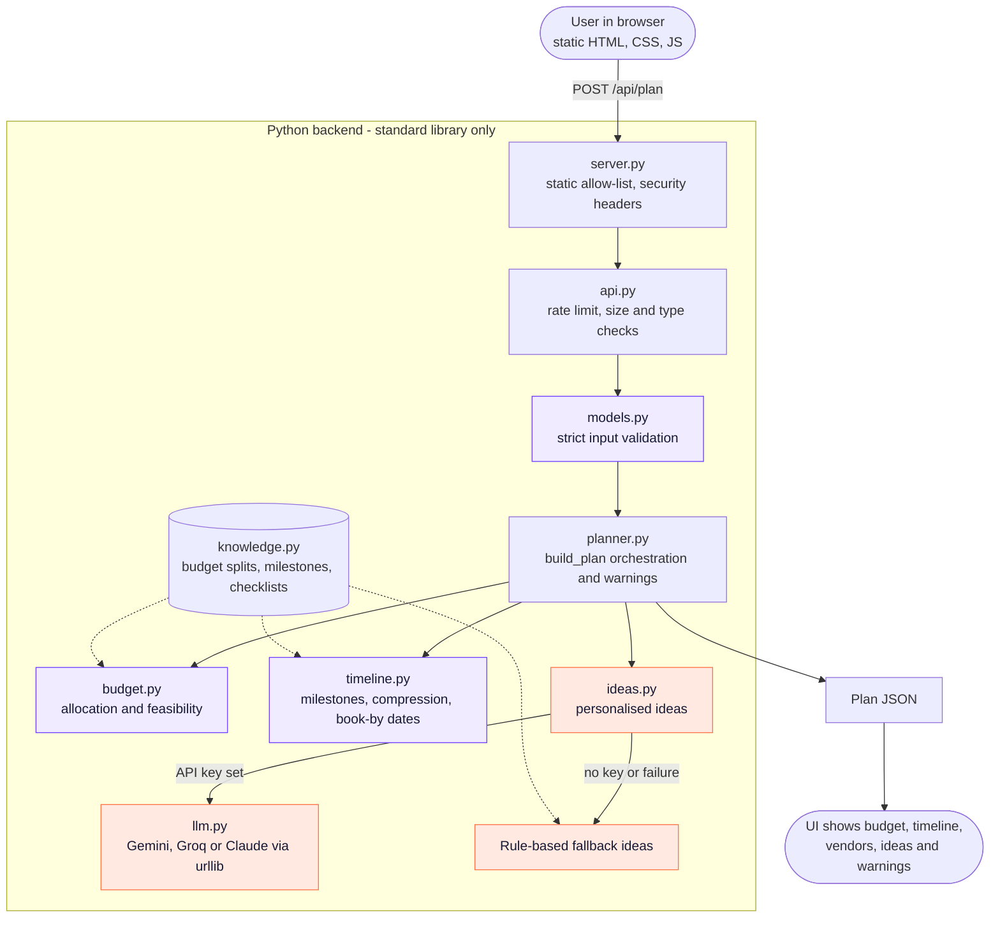

# FestivAI - Celebration & Event Planner

**Live demo:** https://festivai-297907968720.us-central1.run.app

A GenAI-powered planning assistant for **weddings, birthdays and community events**.
Give it the event type, date, guest count, budget and preferences; it returns a
**budget breakdown, a dated timeline, a vendor checklist with book-by dates, and
personalised ideas**, plus warnings when the situation needs attention.

**Zero dependencies** (Python 3.10+ standard library only) - clone, run, done.

## Chosen vertical

Challenge 5: Celebration & Event Planner. Persona: a first-time organiser planning
a wedding, birthday or community event who needs a realistic, actionable plan.

| Brief requirement | Where it is implemented |
|---|---|
| Budgets | `app/budget.py` (per-event splits, preference-aware, exact totals) |
| Timelines | `app/timeline.py` (milestones that compress automatically on short notice) |
| Vendor checklists | `app/planner.py` + `CHECKLISTS` in `app/knowledge.py` (book-by date, spending cap, questions to ask) |
| Personalised ideas (GenAI) | `app/llm.py` (Multi-provider support: Gemini / Claude / Groq) with rule-based fallback in `app/ideas.py` |
| Logical decisions from context | Warnings in `app/planner.py`: short notice, tight per-guest budget, large gatherings |

## Approach and logic

- **Deterministic engine for money and dates.** Numbers must be reproducible and
  testable, so no LLM does arithmetic.
- **GenAI for personalisation.** If an API key is set (`GEMINI_API_KEY`, `ANTHROPIC_API_KEY`,
  or `GROQ_API_KEY` - evaluated in that order), the LLM writes creative ideas tailored to the
  event; otherwise (or on any error) curated rule-based ideas that use the theme, city and
  preferences are returned. The UI states which was used.
- **Context-aware rules.** Preferences (outdoor, live music, vegetarian, photography,
  kids) re-weight the budget. If the event is closer than the ideal lead time, every
  milestone and booking date is scaled so nothing lands in the past.
- **Data separate from logic.** Add an event type by editing `app/knowledge.py` only.

## UI design system

FestivAI features an editorial bento-grid user experience engineered in Vanilla HTML5, CSS3, and ES modules. Total static payload is **under 150 KB**, using the system font stack and a single SVG sprite (`static/icons.svg`).

### Design Tokens (`static/css/tokens.css`)

| Token Category | Variable Name | Value | Purpose / Notes |
|---|---|---|---|
| **Background** | `--color-ivory` | `#FFF9F2` | Warm, celebratory editorial base canvas |
| **Dark / Text** | `--color-navy` | `#171A35` | High-contrast primary typography & dark surfaces |
| **Primary Brand** | `--color-violet` | `#6C3BFF` | Primary action buttons, active tabs, AI badge |
| **Highlight** | `--color-coral` | `#FF7043` | Badges & celebratory accents (Text is navy for AA contrast) |
| **Subtle Accent** | `--color-lavender` | `#F0EBFF` | Card hover states, bento tile backgrounds |
| **Card Surface** | `--color-surface` | `#FFFFFF` | Crisp white cards on ivory canvas |
| **Border** | `--color-border` | `#EAE5F0` | Elegant hairline borders |
| **Muted Text** | `--color-text-secondary`| `#5F5E73` | Strict WCAG AA 4.5:1 contrast compliance on ivory |
| **Radii** | `--radius-sm` to `--radius-lg` | `14px` to `22px` | Soft, modern architectural geometry |
| **Spacing Scale**| `--space-1` to `--space-8` | `8px` to `64px` | Strict 8px baseline rhythm |

### Accessible Screens & Routing (Hash Router)

1. **Home (`#/`)**:
   - Editorial hero (*"Plan the celebration, not the spreadsheet"*).
   - Celebratory inline SVG vector art.
   - Three asymmetric Bento tiles for Weddings, Birthdays, and Community events.
   - Four-step "How It Works" explanation strip.
   - Three "Try a sample" one-click presets that instantly showcase populated plans.
2. **Planner Form (`#/plan`)**:
   - Clean, sectioned single-page flow: *The Basics*, *Budget & Currency*, and *Personalise*.
   - Live client-side validation mirroring server models (guests 1-2000, budget up to 100M, dates today or later).
   - Real checkboxes in semantic `<fieldset>` with accessible chips.
   - Displays server 422 errors and honest loading feedback (*"Building your plan..."*).
3. **Results Dashboard (`#/results`)**:
   - Bento overview with summary, per-head estimate, and feasibility status badge.
   - Warnings alert stack (`role="alert"`).
   - Accessible keyboard-navigable tabs (arrow key support):
     - **Overview**: High-level metrics and immediate next actions.
     - **Budget**: Accessible SVG donut chart, data table fallback, and interactive debounced **"What-If" budget slider**.
     - **Timeline**: Chronological vertical timeline, compressed lead-time indicator, relative date badges, and persistent milestone completion checkboxes.
     - **Vendors**: Prioritized cards by booking deadline, spending caps, and checkable vendor negotiation questions.
     - **Ideas**: Creative concepts tagged with AI or rule-based badges and a refresh action.
4. **My Plans (`#/saved`)**:
   - LocalStorage-backed plan management (no cloud database required).
   - Progress tracking, plan duplication, renaming, deletion with native `<dialog>` confirmation.
   - Plain text copy, JSON export, and print/PDF support.

### Accessibility (WCAG 2.2 AA Compliance)

- **Landmarks**: `<header>`, `<nav>`, `<main id="main">`, `<footer>`.
- **Skip Link**: Top-anchored accessible skip link targeting main content.
- **Focus Management**: Visible 3px violet focus ring (`:focus-visible`), route changes shift focus to view `<h1>`.
- **Hit Targets**: All interactive buttons, chips, and links meet the 44px touch target standard.
- **Charts & Semantics**: SVG donut chart has an equivalent semantic data table (`th scope="col"`) and text descriptions.
- **Assistive Technology**: `aria-live="polite"` toast notifications, `role="alert"` warnings, `role="tablist"` keyboard tabs.
- **Adaptability**: Media query support for `prefers-color-scheme: dark`, `prefers-reduced-motion: reduce`, and `forced-colors: active`.

### Content Security Policy (CSP) Compliance

The server sends `Content-Security-Policy: default-src 'self'; frame-ancestors 'none'`.
- Zero inline `<script>` tags (modular ES script `<script type="module" src="/js/main.js"></script>`).
- Zero `<style>` blocks and zero inline `style=""` attributes in markup.
- Zero inline event handlers (no `onclick`, no `onchange`).
- All data rendering is performed strictly via `textContent` and DOM node builders (`createElement`, `appendChild`). **No `innerHTML` or `eval` anywhere in JavaScript.**
- Static allow-list (`STATIC_FILES`) is built on startup, mapping exact paths to ensure zero directory traversal.

## How it works

```
Browser form -> POST /api/plan -> validation -> budget + timeline + vendors + ideas -> JSON -> accessible UI
```

## Architecture



| Module | Responsibility |
|---|---|
| `knowledge.py` | All domain data: budget splits, milestones, checklists, fallback ideas |
| `models.py` | Input validation and response dataclasses |
| `budget.py`, `timeline.py` | Pure, deterministic calculations |
| `ideas.py`, `llm.py` | Personalised ideas with graceful fallback |
| `planner.py` | Combines the pieces and raises context-aware warnings |
| `api.py` | Transport-independent request handling and rate limiting |
| `server.py` | Thin HTTP layer and static file serving |

### Design decisions

- **Deterministic core, GenAI at the edge.** Money and dates come from pure
  functions, so they are reproducible and testable. The LLM only writes ideas.
- **Always works offline.** With no API key, or on any LLM failure, rule-based
  ideas are returned and the UI says which kind it received.
- **Data separate from logic.** Adding an event type means editing `knowledge.py`.
- **Testable seams.** The idea function and HTTP opener are injected, so the
  tests never touch the network.
- **Security boundaries.** All input is validated at one entry point; static
  files come from an explicit allow-list; the API key is read from the
  environment and sent only in a request header.

## Run it

```bash
# 1. Start the service (Zero dependencies, pure Python standard library):
python -m app.server

# 2. Open in your browser:
# http://127.0.0.1:8000

# 3. Run the comprehensive test suite (offline unit and security tests):
python -m unittest -v
```

## Development

```bash
# Install development tooling:
pip install ruff

# Run unit and integration tests:
python -m unittest -v

# Run code style and quality linter:
ruff check .
```

### Optional GenAI Personalisation

Export any of the supported API keys in your environment, or configure in a local `.env` file
(never commit real keys):
```bash
# Google Gemini (evaluated first when multiple keys are set):
export GEMINI_API_KEY=AIzaSy...

# Anthropic Claude (evaluated second):
export ANTHROPIC_API_KEY=your_key_here

# Groq (evaluated third):
export GROQ_API_KEY=gsk_...
```
*Provider evaluation priority: Gemini is selected first, then Anthropic Claude, then Groq.
API keys are sent strictly in HTTP request headers (`x-goog-api-key` for Gemini, `x-api-key` for
Claude, or `Authorization: Bearer` for Groq), never in URLs. Requests enforce a 15-second timeout.
If no key is set or a network error occurs, the service seamlessly falls back to curated
rule-based ideas.*

## Security

Strict server-side validation (types, ranges, lengths, allow-lists, control-character
stripping); 8 KB request size cap; per-client sliding-window rate limiting with bounded memory;
explicit static-file allow-list (no path traversal); CSP and security headers; API key read from
the environment only and sent only in a request header (`x-goog-api-key`, `x-api-key`, or
`Authorization: Bearer`), never in a URL; user text passed to the LLM as delimited data with
output parsed, capped and validated; UI renders with `textContent` (no `innerHTML`).

## Efficiency

No database, no per-request I/O beyond one optional LLM call (15 s timeout), cached
static files, O(n) pure functions.

## Assumptions

- Budget shares, milestones and per-guest floors are general guidelines, not local
  price quotes; the feasibility rating applies to INR only.
- Ideas never include prices or vendor names.
- No user data is stored on the server (client-side plans live in browser `localStorage`).
- When an API key is set, the event details entered in the form (type, date, guest count,
  budget, city, theme, preferences) are sent to the selected AI provider; no account
  identifiers are sent.
- Dates use the server's local date.

## Project structure

```
.dockerignore      # Files excluded from container build
.env.example       # Example environment variables template
.gitattributes     # Git line-ending attributes
.github/
  workflows/
    ci.yml         # GitHub Actions CI workflow (Python 3.12 unittest)
.gitignore         # Files excluded from version control
Dockerfile         # Container definition for Google Cloud Run
LICENSE            # MIT License
README.md          # Project documentation and guide
pyproject.toml     # Ruff linter configuration and Python target
app/
  __init__.py      # Package marker
  api.py           # Rate limiting & HTTP request handling
  budget.py        # Exact budget calculation & feasibility
  ideas.py         # Hybrid idea generator with rule fallback
  knowledge.py     # Domain splits, milestones, checklists, fallback ideas
  llm.py           # Standard library urllib LLM client (Gemini / Claude / Groq)
  models.py        # Strict validation & dataclasses
  planner.py       # Plan orchestration & context warnings
  server.py        # Zero-dependency HTTP server & static allow-list
  timeline.py      # Timeline generation & lead-time compression
static/
  app.js           # Legacy ES entry point
  icons.svg        # Scalable SVG vector icon sprite
  index.html       # CSP-safe semantic HTML entry point
  style.css        # Master stylesheet aggregator
  css/
    base.css       # Landmarks, skip link, reset & print stylesheet
    components.css # Buttons, cards, bento tiles, badges, forms, tabs, dialogs
    tokens.css     # Design tokens, color palette, dark mode & typography
    views.css      # Screen layouts for Home, Planner, Dashboard & Saved
  js/
    api.js         # Fetch client for /api/plan
    format.js      # Pure currency & date formatting
    main.js        # Application initialization
    router.js      # Accessible hash router with title & focus management
    state.js       # Reactive state management
    storage.js     # Safe localStorage persistence
    validate.js    # Client-side input validation mirroring server rules
    components/
      dialog.js    # Modal dialog component
      donut.js     # SVG donut chart component
      icons.js     # Icon helper component
      toast.js     # Accessible toast notification component
      warnings.js  # Warning alert banner component
    views/
      home.js      # Home view renderer
      plan.js      # Plan form view renderer
      results.js   # Results dashboard view renderer
      saved.js     # Saved plans view renderer
tests/
  __init__.py      # Test package marker
  helpers.py       # Shared test fixtures & factory functions
  test_api.py      # Status codes & rate limiter tests
  test_budget.py   # Exact split sums & preference tests
  test_llm.py      # Prompt hardening & fallback tests
  test_models.py   # Validation bounds & sanitization tests
  test_planner.py  # Plan assembly & warning triggers
  test_server.py   # Server round-trip & traversal protection
  test_static.py   # CSP compliance, no innerHTML/eval & asset availability
  test_timeline.py # Lead-time compression tests
```
